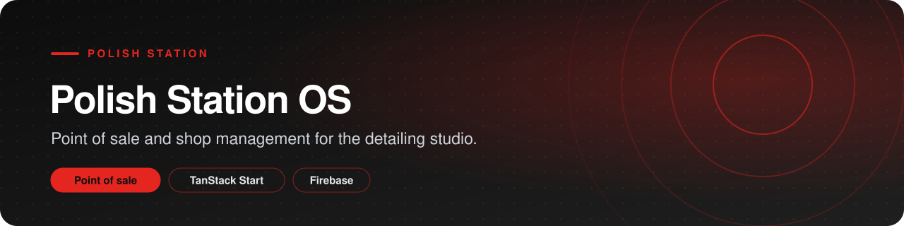
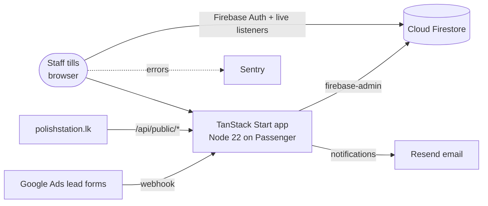
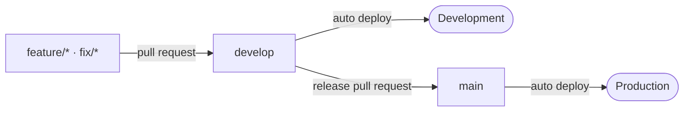

<a id="readme-top"></a>

<div align="center">



<br/><br/>

<p><strong>Bookings, check-in, inspections, jobs, checkout, invoicing, inventory, purchasing, staff and reporting, live across every till.</strong></p>

<a href="https://github.com/saadmaz/Polish-Station-POS/releases"></a>
<a href="https://github.com/saadmaz/Polish-Station-POS/actions/workflows/ci.yml"></a>
<a href="https://github.com/saadmaz/Polish-Station-POS/deployments"></a>
<a href="https://github.com/saadmaz/Polish-Station-POS/commits/develop"></a>


<br/><br/>

<a href="https://www.pos.polishstation.lk"></a>
<a href="docs/README.md"></a>
<a href="https://github.com/saadmaz/Polish-Station-POS/issues/new?template=bug_report.yml"></a>
<a href="https://github.com/saadmaz/Polish-Station-POS/issues/new?template=feature_request.yml"></a>

<br/><br/>

<a href="#about">About</a> ·
<a href="#features">Features</a> ·
<a href="#architecture">Architecture</a> ·
<a href="#getting-started">Getting started</a> ·
<a href="#deployment">Deployment</a> ·
<a href="#documentation">Documentation</a> ·
<a href="#contributing">Contributing</a>

</div>

---

<details>
<summary><strong>Table of contents</strong></summary>

1. [About](#about)
2. [Features](#features)
3. [Architecture](#architecture)
4. [Tech stack](#tech-stack)
5. [Getting started](#getting-started)
6. [Configuration](#configuration)
7. [Project structure](#project-structure)
8. [Quality checks](#quality-checks)
9. [Deployment](#deployment)
10. [Documentation](#documentation)
11. [Releases and versioning](#releases-and-versioning)
12. [Contributing](#contributing)
13. [Security](#security)
14. [License](#license)

</details>

## About

Polish Station POS runs the day-to-day operation of the Polish Station detailing studio in Dehiwala, Sri Lanka. Staff use it on shared tills to take bookings, check vehicles in, record inspections, run jobs, take payment and manage stock, while the website feeds it leads, bookings and subscribers through a public intake API.

|                  |                                                          |
| ---------------- | -------------------------------------------------------- |
| **Organisation** | Polish Station (Pvt) Ltd                                 |
| **Status**       | Live                                                     |
| **Production**   | [pos.polishstation.lk](https://www.pos.polishstation.lk) |
| **Contact**      | [info@polishstation.lk](mailto:info@polishstation.lk)    |
| **Maintainer**   | [Saad Mazhar](https://github.com/saadmaz)                |

<p align="right"><a href="#readme-top">Back to top ↑</a></p>

## Features

<table>
<tr><td width="50%" valign="top"><strong>Sign-in</strong><br/>Tap-your-name staff picker with a 4-digit PIN, forced PIN change on first login, lockout after failed attempts and an encrypted offline PIN fallback on enrolled tills</td><td width="50%" valign="top"><strong>Dashboard</strong><br/>The day at a glance: bookings, jobs in progress, revenue and alerts</td></tr>
<tr><td width="50%" valign="top"><strong>Bookings</strong><br/>Calendar of bookings with booking rules, check-in and conversion to jobs</td><td width="50%" valign="top"><strong>Inspection</strong><br/>Vehicle check-in with a damage diagram and a printable inspection report</td></tr>
<tr><td width="50%" valign="top"><strong>Jobs</strong><br/>Work in progress from check-in to handover</td><td width="50%" valign="top"><strong>POS / Checkout</strong><br/>Invoices, payments, discounts and coupons, refunds (manager and above) and WhatsApp review requests</td></tr>
<tr><td width="50%" valign="top"><strong>Customers and vehicles</strong><br/>Customer profiles, vehicle history and visit records</td><td width="50%" valign="top"><strong>Leads, inquiries and subscribers</strong><br/>Website and Google Ads lead intake with a full lead lifecycle and conversion to customers</td></tr>
<tr><td width="50%" valign="top"><strong>Inventory and purchase orders</strong><br/>Stock levels, low-stock alerts and receiving against purchase orders</td><td width="50%" valign="top"><strong>Equipment</strong><br/>Maintenance log and costs</td></tr>
<tr><td width="50%" valign="top"><strong>Notifications</strong><br/>Reminders and follow-ups</td><td width="50%" valign="top"><strong>Reports</strong><br/>Revenue, jobs and operational reporting</td></tr>
<tr><td width="50%" valign="top"><strong>Staff and settings</strong><br/>Roster, roles, per-module permissions, devices and business settings</td><td></td></tr>
</table>

<p align="right"><a href="#readme-top">Back to top ↑</a></p>

## Architecture

A TanStack Start application on Node.js 22 under Passenger, with Cloud Firestore as the single source of truth. Every screen is a live listener, staff sign in client-side against Firebase Auth, and Firestore rules enforce roles and per-module permissions at the data layer. Public endpoints accept submissions from the website and ad platforms.



> [!TIP]
> The full design, with every component and data flow, is in [docs/ARCHITECTURE.md](docs/ARCHITECTURE.md). Significant decisions are recorded as [architecture decision records](docs/adr/README.md).

<p align="right"><a href="#readme-top">Back to top ↑</a></p>

## Tech stack

<p>


</p>

<details>
<summary><strong>Full stack breakdown</strong></summary>

| Layer         | Technology                                                                                 |
| ------------- | ------------------------------------------------------------------------------------------ |
| Framework     | [TanStack Start](https://tanstack.com/start) (React 19, file-based routing, server routes) |
| Language      | TypeScript                                                                                 |
| Styling       | Tailwind CSS v4 and Radix-based UI primitives                                              |
| Data and auth | Firebase (Cloud Firestore, Authentication, Storage) and `firebase-admin` on the server     |
| Email         | Resend                                                                                     |
| Monitoring    | Sentry                                                                                     |
| Build         | Vite, with the server bundled into a single file                                           |
| Hosting       | Node.js 22 on Phusion Passenger (cPanel), deployed by GitHub Actions                       |
| Tooling       | npm, Vitest, Playwright, Firebase Emulator Suite, ESLint, Prettier                         |

</details>

<p align="right"><a href="#readme-top">Back to top ↑</a></p>

## Getting started

### Prerequisites

- Node.js 22 (see [`.nvmrc`](.nvmrc))
- npm 10 or later
- [Firebase CLI](https://firebase.google.com/docs/cli) for the emulators and rules tests
- Java 17 or later (required by the Firestore emulator)

### Install and run

```sh
git clone https://github.com/saadmaz/Polish-Station-POS.git
cd Polish-Station-POS
npm ci
cp .env.example .env    # fill in the Firebase web config and server credentials
npm run dev
```

Vite prints the local address when the server starts. Point `VITE_FIREBASE_*` at a development Firebase project, never production. `scripts/seed-emulator.mjs` seeds the Firebase emulators with test fixtures and refuses to run against a real project.

<details>
<summary><strong>All scripts</strong></summary>

| Command                           | Description                                               |
| --------------------------------- | --------------------------------------------------------- |
| `npm run dev`                     | Start the development server                              |
| `npm run build`                   | Production build: client, server bundle and build id      |
| `npm start`                       | Run the production server (`start.mjs`)                   |
| `npm run lint`                    | Lint with ESLint (includes Prettier rules)                |
| `npm run typecheck`               | Type-check with `tsc`                                     |
| `npm run format` / `format:check` | Format with Prettier, or check without writing            |
| `npm test`                        | Unit tests (Vitest)                                       |
| `npm run test:rules`              | Firestore security rules tests (starts the emulator)      |
| `npm run test:e2e`                | End-to-end flows against the Firestore and Auth emulators |
| `npm run deploy:rules`            | Deploy Firestore and Storage rules and indexes            |
| `npm run seed:*`, `migrate:*`     | Data seeding and one-off migrations (see `scripts/`)      |

</details>

<p align="right"><a href="#readme-top">Back to top ↑</a></p>

## Configuration

Firebase web config, the server's service account, Resend, Sentry, the Google Ads webhook key and the bootstrap SuperAdmin are set in `.env`. Business settings are managed in the app under **Settings**.

<details>
<summary><strong>Environment variables</strong></summary>

| Variable                                                               | Purpose                                                                    |
| ---------------------------------------------------------------------- | -------------------------------------------------------------------------- |
| `VITE_FIREBASE_*`                                                      | Firebase web app config (public identifiers compiled into the client)      |
| `FIREBASE_PROJECT_ID`, `FIREBASE_CLIENT_EMAIL`, `FIREBASE_PRIVATE_KEY` | Service account for `firebase-admin` on the server. **Secret**             |
| `VITE_SENTRY_DSN`                                                      | Sentry error reporting                                                     |
| `RESEND_API_KEY`, `LEADS_NOTIFY_EMAIL`                                 | Lead notification email. **Secret**                                        |
| `GOOGLE_ADS_LEAD_WEBHOOK_KEY`                                          | Shared key that authenticates the Google Ads lead-form webhook. **Secret** |
| `SUPERADMIN_USERNAME`, `SUPERADMIN_PIN`                                | Bootstrap SuperAdmin used by `seed:admin`. **Secret**                      |

Where each value is set, and which are secret: [docs/CONFIGURATION.md](docs/CONFIGURATION.md).

</details>

<p align="right"><a href="#readme-top">Back to top ↑</a></p>

## Project structure

<details>
<summary><strong>Repository layout</strong></summary>

```
.
├── .github/workflows/       # CI, deploy, rules deploy, keep-warm and server maintenance
├── docs/                    # Feature map, deployment, booking rules, lead lifecycle, integrations, audits
├── public/                  # Static assets
├── scripts/                 # Build helpers, seeding, migrations, rules and e2e tests
├── src/
│   ├── components/          # Feature components and Radix-based UI primitives
│   ├── hooks/               # Shared hooks: focus trap, confirmation, step-up PIN, photo queue
│   ├── lib/                 # Firebase clients, auth, domain logic (jobs, leads, inspections, money) and tests
│   ├── routes/              # File-based routes: staff app (_app.*), public API (api.public.*)
│   ├── server/              # Server-only modules
│   └── styles.css           # Design tokens and global styles
├── firestore.rules          # Data-layer security rules
├── storage.rules            # Storage security rules
├── htaccess                 # Apache / Passenger configuration deployed as .htaccess
└── start.mjs                # Production entry point
```

</details>

<p align="right"><a href="#readme-top">Back to top ↑</a></p>

## Quality checks

Every pull request into `develop` or `main` runs the [CI workflow](.github/workflows/ci.yml): lint, formatting, type check, unit tests and a production build. Pull requests merge only when CI is green.

```sh
npm run lint && npm run format:check && npm run typecheck && npm test && npm run build
```

> [!IMPORTANT]
> Run the same checks locally before opening a pull request. They are the exact commands CI runs.

<p align="right"><a href="#readme-top">Back to top ↑</a></p>

## Deployment

| Environment | Branch    | URL                                                          | Status                                                                                                                                                               |
| ----------- | --------- | ------------------------------------------------------------ | -------------------------------------------------------------------------------------------------------------------------------------------------------------------- |
| Development | `develop` | [dev.pos.polishstation.lk](https://dev.pos.polishstation.lk) |  |
| Production  | `main`    | [www.pos.polishstation.lk](https://www.pos.polishstation.lk) |     |



The Deploy workflow builds on GitHub Actions and uploads over FTPS to Passenger. Environments, setup, secrets and post-deployment checks are in [docs/DEPLOYMENT.md](docs/DEPLOYMENT.md).

> [!TIP]
> To ship or undo a release, follow the [release](docs/runbooks/release.md) and [rollback](docs/runbooks/rollback.md) runbooks.

<p align="right"><a href="#readme-top">Back to top ↑</a></p>

## Documentation

Every STTPS repository uses the same documentation layout.

| Document                               | Covers                                               |
| -------------------------------------- | ---------------------------------------------------- |
| [Documentation index](docs/README.md)  | Every document in this repository                    |
| [Architecture](docs/ARCHITECTURE.md)   | How the system is built and how data flows           |
| [Configuration](docs/CONFIGURATION.md) | Environment variables and configuration files        |
| [Deployment](docs/DEPLOYMENT.md)       | Environments, hosting, pipeline and first-time setup |
| [Decision records](docs/adr/README.md) | Why the system is built the way it is                |
| [Runbooks](docs/runbooks/README.md)    | Release and rollback procedures                      |

<p align="right"><a href="#readme-top">Back to top ↑</a></p>

## Releases and versioning

[](https://github.com/saadmaz/Polish-Station-POS/releases)

The project follows [Semantic Versioning](https://semver.org). Every release is tagged `vX.Y.Z`, published on the [Releases](https://github.com/saadmaz/Polish-Station-POS/releases) page with its notes, and recorded in [CHANGELOG.md](CHANGELOG.md). The procedure is in [docs/runbooks/release.md](docs/runbooks/release.md).

<p align="right"><a href="#readme-top">Back to top ↑</a></p>

## Contributing

| Step |                                                                           |
| ---- | ------------------------------------------------------------------------- |
| 1    | Branch from `develop` using a type prefix (`feat/`, `fix/`, `docs/`, ...) |
| 2    | Commit with [Conventional Commits](https://www.conventionalcommits.org)   |
| 3    | Open a pull request into `develop` and complete the checklist             |
| 4    | Squash and merge once CI is green and the change is reviewed              |

The full guide is in [CONTRIBUTING.md](CONTRIBUTING.md). Everyone taking part follows the [Code of Conduct](CODE_OF_CONDUCT.md).

<p align="right"><a href="#readme-top">Back to top ↑</a></p>

## Security

> [!IMPORTANT]
> Never report a vulnerability in a public issue. Follow [SECURITY.md](SECURITY.md) to report it privately; you will hear back within three business days.

<p align="right"><a href="#readme-top">Back to top ↑</a></p>

## License

Copyright © 2026 Polish Station (Pvt) Ltd. All rights reserved.

This is proprietary software. The source is publicly visible, but no permission is granted to use, copy, modify or distribute it without prior written consent. See [LICENSE](LICENSE).

<div align="center">
<br/>
<sub>Built and maintained by the Polish Station team · Part of the <a href="https://sttps.co">STTPS group</a></sub>
</div>
