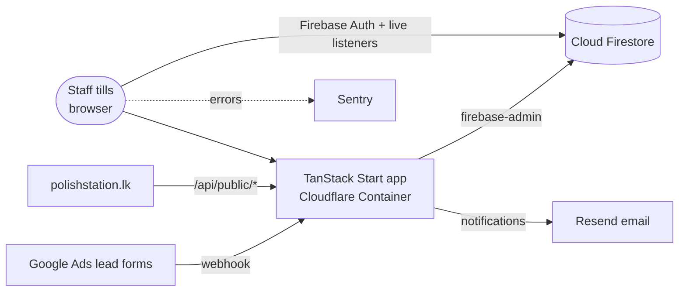

# Architecture

<!-- nav -->

<a href="../README.md">Project README</a> · <a href="README.md">Documentation index</a>

> How Polish Station POS is built. Part of the [project documentation](README.md).

## Overview

- **Firestore is the single source of truth.** Every screen is a live listener, so every till sees changes from every other till in real time.
- **Sign-in is client-side** against Firebase Auth, with no server round trip on login. Deactivating or demoting a user revokes their session immediately.
- **Security rules** in [`firestore.rules`](../firestore.rules) and [`storage.rules`](../storage.rules) enforce roles and permissions at the data layer, with emulator-based rules tests.
- **Public intake endpoints** (`/api/public/booking`, `/contact`, `/newsletter`, `/google-leadform`) accept submissions from the website and ad platforms.

## Access control

Access is enforced on two axes carried in the Firebase ID token and checked both in the UI and in `firestore.rules`:

| Axis            | Controls                                                                            |
| --------------- | ----------------------------------------------------------------------------------- |
| **Role**        | What a user may do: `Technician < Cashier = Advisor < Manager < Admin < SuperAdmin` |
| **Permissions** | Which of the modules a user may see, set per user by a SuperAdmin                   |

The full module tour, with flow diagrams, is in [FEATURES.md](FEATURES.md).

## Building blocks

| Part                               | Responsibility                                                                            |
| ---------------------------------- | ----------------------------------------------------------------------------------------- |
| `src/routes/_app.*`                | Staff application screens                                                                 |
| `src/routes/api.public.*`          | Public intake endpoints for the website and ad platforms                                  |
| `src/routes/healthz.ts`            | Health check used by the deploy warm-up                                                   |
| `server.mjs`                       | Production Node server: static assets, security headers, and the app handler              |
| `worker/index.ts`                  | Cloudflare Worker that forwards requests to the container                                 |
| `src/lib/`                         | Firebase clients, auth and domain logic (jobs, leads, inspections, money) with unit tests |
| `src/server/`                      | Server-only modules                                                                       |
| `firestore.rules`, `storage.rules` | Data-layer security rules                                                                 |

Significant decisions are recorded in [adr/](adr/README.md).
