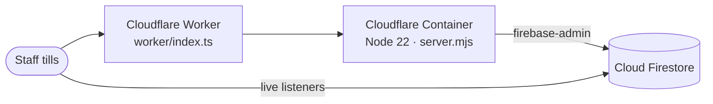

# Deployment

<!-- nav -->

<sub><a href="../README.md">Project README</a> · <a href="README.md">Documentation index</a></sub>

> How Polish Station OS reaches production. Part of the [project documentation](README.md).

> [!IMPORTANT]
> The app runs on **Cloudflare**: a Worker in front of the Node server in a Cloudflare Container. Production deploys switch on with the `CLOUDFLARE_ENABLED` repository variable. Nothing is served at os.polishstation.lk until you switch them on and attach the domain.

## Environments

| Environment   | Branch    | URL                                                        | Cloudflare Worker               |
| ------------- | --------- | ---------------------------------------------------------- | ------------------------------- |
| `development` | `develop` | [dev.os.polishstation.lk](https://dev.os.polishstation.lk) | `polish-station-os-development` |
| `production`  | `main`    | [os.polishstation.lk](https://os.polishstation.lk)         | `polish-station-os`             |

Each is a GitHub Environment with its own variables (`APP_URL`) and secrets. Production accepts deployments from `main` only; development from `develop` only.

### Promotion

1. Feature branches merge into `develop` and deploy to development (once `DEVELOPMENT_ENABLED` is `true`).
2. A release pull request from `develop` into `main` (see [runbooks/release.md](runbooks/release.md)) promotes the change.
3. Merging it deploys to production (once `CLOUDFLARE_ENABLED` is `true`).

## How it runs



| File                                    | Role                                                                                                                                                        |
| --------------------------------------- | ----------------------------------------------------------------------------------------------------------------------------------------------------------- |
| [`server.mjs`](../server.mjs)           | Node server: serves `dist/client`, passes every other request to the app, and sets the Content Security Policy, security headers and one-year asset caching |
| [`Dockerfile`](../Dockerfile)           | Production image: production dependencies, the build output and `server.mjs`, run as a non-root user                                                        |
| [`worker/index.ts`](../worker/index.ts) | Worker that forwards requests to one shared container instance and passes runtime secrets to it; the instance sleeps after 30 idle minutes                  |
| [`wrangler.jsonc`](../wrangler.jsonc)   | Worker, container and Durable Object configuration for production and development                                                                           |

## How a deploy works

[`deploy.yml`](../.github/workflows/deploy.yml) runs on every push to `main` or `develop`:

1. Install dependencies and run `npm run build` with the environment's Firebase web config.
2. Deploy with Wrangler, which builds the container image from the `Dockerfile`, publishes the Worker and uploads the runtime secrets.
3. Smoke-test `/healthz`, which must return `ok`.

## First-time setup

1. **Cloudflare API token.** Create a token with the _Edit Cloudflare Workers_ template plus _Containers: Edit_, and store it as the `CLOUDFLARE_API_TOKEN` repository secret. `CLOUDFLARE_ACCOUNT_ID` is already set as a repository variable.
2. **Runtime secrets.** `FIREBASE_PROJECT_ID`, `FIREBASE_CLIENT_EMAIL` and `FIREBASE_PRIVATE_KEY` are already repository secrets. Add `RESEND_API_KEY`, `LEADS_NOTIFY_EMAIL` and `GOOGLE_ADS_LEAD_WEBHOOK_KEY` from the old server's `.env`, and `VITE_SENTRY_DSN` if Sentry is used.
3. **Switch on deploys.** Set the repository variable `CLOUDFLARE_ENABLED` to `true`, then run the **Deploy** workflow on `main`.
4. **Domains.** First add `os.polishstation.lk` to `SERVICE_HOSTS` (with a `services` binding to `polish-station-os`) in the `polish-station-maintenance` Worker and redeploy it; its `*.polishstation.lk` route otherwise answers the new hostname with the maintenance page. Then add `os.polishstation.lk` as a custom domain in this Worker's settings.
5. **Cut over.** Confirm staff can sign in on the Cloudflare URL, then retire the previous host.
6. Repeat steps 2 to 4 for development with `dev.os.polishstation.lk`, then set `DEVELOPMENT_ENABLED` to `true`.

## Run the production build locally

```sh
npm run build
npm start                  # node server.mjs on http://localhost:8080 (needs the FIREBASE_* server variables)
docker build -t pos . && docker run -p 8080:8080 --env-file .env pos
```

## Firestore and Storage rules

Rules and indexes deploy independently of hosting, through [`firebase-deploy.yml`](../.github/workflows/firebase-deploy.yml), whenever `firestore.rules`, `firestore.indexes.json` or `storage.rules` change on `main`. To deploy manually:

```sh
firebase deploy --only firestore:rules,firestore:indexes,storage
```

## Seed data

There are no schema migrations: Firestore is schemaless. One-time setup runs from a local machine, never automatically:

```sh
npm run seed:staff   # staff accounts with bcrypt-hashed PINs from .env
npm run seed:data    # services, customers, inventory, bookings, jobs, equipment, purchase orders
```

> [!WARNING]
> `seed:staff` overwrites every staff PIN hash. Run it once during initial setup and never again in production. `seed:data` is safe to re-run; it skips collections that already have documents unless you pass `--force`.

## Backups

- **Code:** GitHub is the source of truth; every release is tagged.
- **Firestore:** enable scheduled backups in Firebase Console → Firestore → Backups with a daily schedule and 7 to 14 days' retention. Before any risky manual data operation, run `gcloud firestore export gs://<backup-bucket>`.
- **Secrets:** keep a copy of the production values in the team password manager.

## Post-deployment checks

1. `/healthz` returns `ok`.
2. A staff member can sign in with their PIN, and an enrolled till can sign in offline.
3. A booking submitted from [polishstation.lk](https://www.polishstation.lk/book) appears in Bookings.
4. Response headers include the Content Security Policy and `Strict-Transport-Security`.
